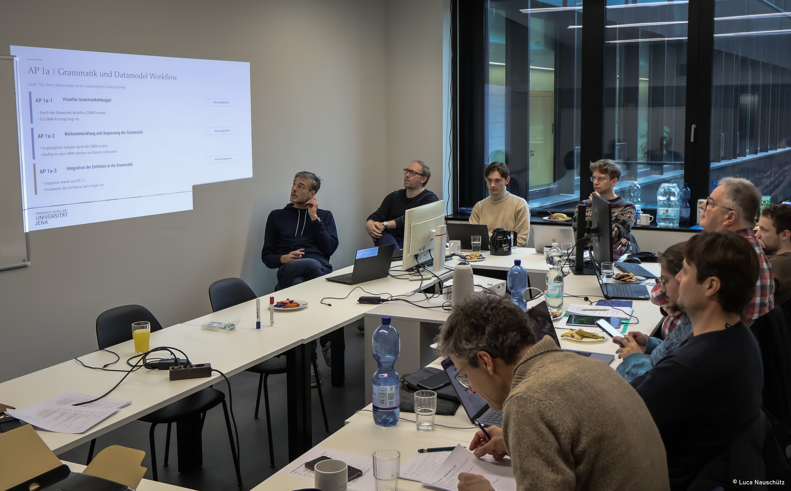

Zwei produktive Workshoptage liegen hinter uns: Am 5. und 6. November 2026 kam das HisQu-Projektteam am Campus Inselplatz der Friedrich-Schiller-Universität Jena zusammen. Im Mittelpunkt standen die bisherigen Ergebnisse, offene Aufgaben und die Frage, wie die einzelnen Projektkomponenten zu einer integrierten Forschungsumgebung zusammenwachsen können.

Einen Schwerpunkt bildete die Arbeit an der Ontologie. Die Projektpartner diskutierten intensiv ihre Verwendung und verfeinerten sie gemeinsam. Die Vorstellung von vier Use Cases bot konkrete Anknüpfungspunkte, um Fragen der Modellierung zu erörtern und die entwickelten Ansätze an unterschiedlichen Anwendungsszenarien zu betrachten. So kam ebenfalls die Arbeit am Datenmodellworkflow voran und wurde ausführlich diskutiert. Hierzu präsentierten die Teilnehmenden erste Ergebnisse aus Interviews mit Domänenexpertinnen und -experten. Diese Einblicke brachten die Anforderungen der Forschenden in die Diskussion ein und lieferten wichtige Impulse für die weitere Entwicklung.
Eng damit verbunden waren Fragen der technischen Integration und der gemeinsamen Architektur: Wie greifen NEI, Datenmodellworkflow, Ontologie, ResearchSpace und UX ineinander? Welche Schnittstellen werden benötigt, damit aus den einzelnen Komponenten ein zusammenhängender Forschungsprozess entsteht? Der Austausch half dabei, Abhängigkeiten sichtbar zu machen und die noch anstehenden Aufgaben gemeinsam zu konkretisieren. Alle Projektpartner nutzten die Gelegenheit, ihre nächsten Schritte abzugleichen.

Über die laufenden Arbeiten hinaus richtete sich der Blick auf die Zukunft von HisQu. Gemeinsam wurden Ideen für Folgeanträge diskutiert und Perspektiven für eine Fortführung der Zusammenarbeit ausgelotet. Auch die Pausen kamen nicht zu kurz: Sie boten Raum, Gespräche in kleinerer Runde fortzusetzen und sich abseits der Tagesordnung auszutauschen.

Wir danken allen Beteiligten für die intensive und konstruktive Zusammenarbeit. Mit einem geschärften Blick auf die offenen Aufgaben und neuen Impulsen aus Jena gehen wir in die nächste Phase der gemeinsamen Arbeit an HisQu.

